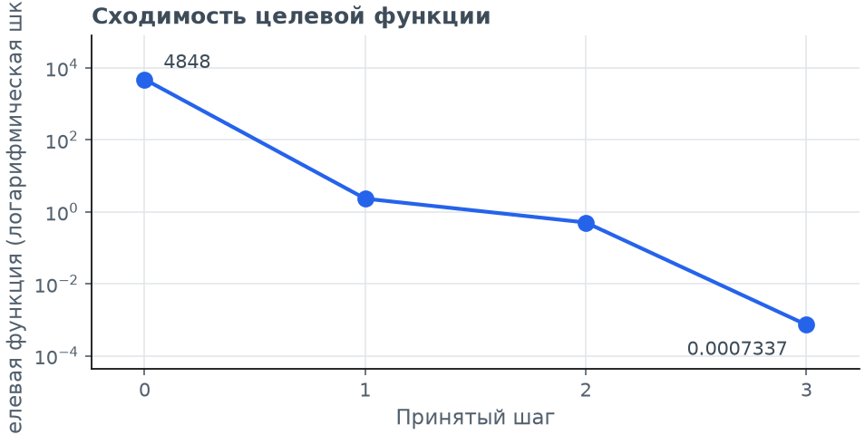
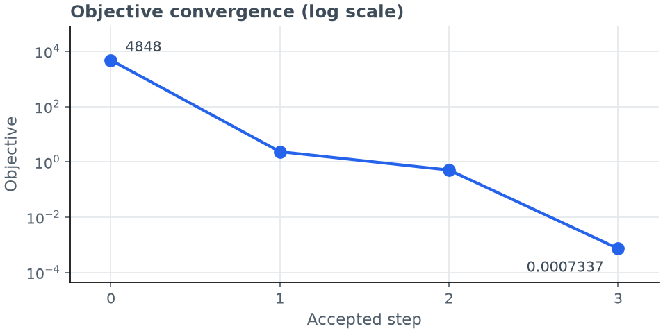
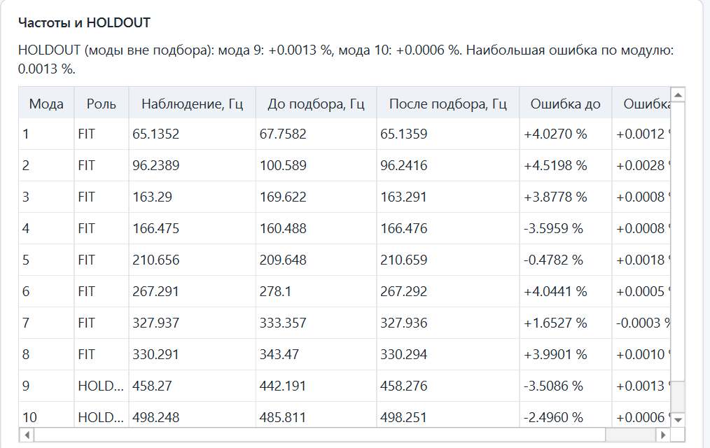
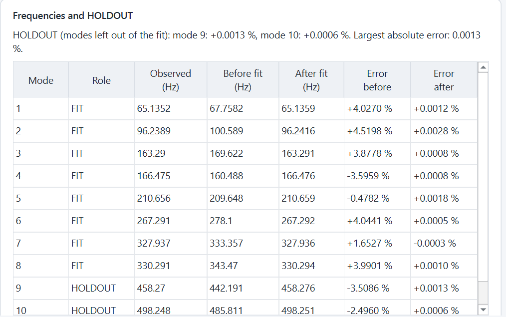
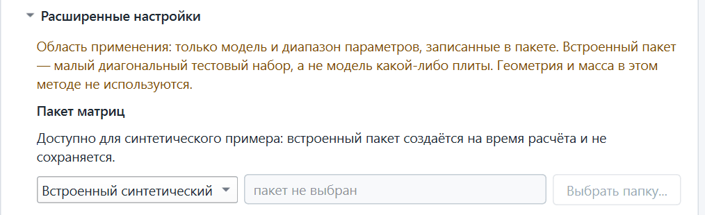
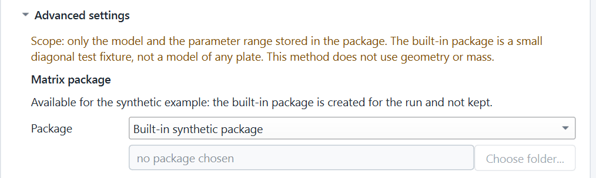

# MAT-4.UX1.F1 report: English-only Materials GUI and the three smoke-test defects

Status: **MAT-4.UX1.F1 REVIEW_READY**. Not self-accepted.

For the owner and the reviewer. Base and parent: `c7f69188a800dd0edaecacdc10cadded7c527cca`; branch `feature/materials-offline-v1`;
`origin/main` `0bea1de68dc346d20958e6f53a9e1d634a870f5d`. The final SHA is in the hand-over, since a file cannot name the commit that
contains it.

M8 GATE NOT_MET, D-077 NO_GLOBAL_PARAMETER_VALUE and production Auto-ID BLOCKED are unchanged. Real-data inverse execution stays BLOCKED. No
Abaqus run, FE calculation, real-data fit or material release took place.

## What changed

**English only.** MAT-4.UX1 put the Materials page in Russian; every user-facing string of the new GUI is English again. That covers the five tabs,
buttons, advanced settings, table headers, summaries, tooltips, messages, refusals, file dialogs and plot text. Where MAT-3 had an English
wording, it is restored. Status codes, the saved statement, provenance, the project schema and result hashes are unchanged. Projects saved by
MAT-4.UX1 open with identical result hashes.

Tabs: Calculation · Results · Plots · Diagnostics · FE / Experiment. Methods: "Ritz plate model", "Stage A matrix model".

**D1, clipped Y label of the convergence plot (both methods).** The rotated label "Целевая функция (логарифмическая шкала)" was taller than the
axis at the smallest plot height. In the old layout it reached from −16 to 532 pixels in a 480-pixel picture. The label is now "Objective", and
"(log scale)" moved to the title. Plot building (`objective_figure`, `error_figure`) is now separate from PNG encoding, so a test can measure
where the text is drawn.

**D2, frequency table at 900 × 700.** "HOLDOUT" was cut to "HOLD…", and "Error after" needed sideways scrolling.
- No column of the Results frequency table is narrower than its header or its longest cell.
- The free width is shared equally between the columns instead of going to "Role". This also fixes the over-wide Role column at 1366.
- Headers take two lines: "Observed (Hz)", "Error after".

On the real screen at 900 the columns need 482 of 634 pixels. Values, FIT/HOLDOUT roles and column meanings are unchanged.

**D3, Stage A package choice.** The list now has its own row at the card's width; the path field and "Choose folder..." are on the row below.
Each entry has a tooltip. The mass-basis list shows "Mass" / "Surface mass", because the unit is already in the caption.

| | Before (MAT-4.UX1, 900 × 700, 150 %) | After (900 × 700, 150 %) |
|---|---|---|
| D1 |  |  |
| D2 |  |  |
| D3 |  |  |

## Changed files

- `src/new_gui/materials_study_model.py`: English strings, figure functions, short plot labels. No numerical code changed.
- `src/new_gui/materials_study_panel.py`: English strings. The `fill` table mode (D2), the package row (D3) and the mass-basis column share.
- `src/new_gui/materials_workspace.py`, `materials_workspace_model.py`, `materials_status_panel.py`, `production_window.py`: English strings.
- `tests/test_mat4_ux1_materials_gui.py`: English expectations and two new test classes:
  - `EnglishOnly`: no Cyrillic in any visible text, tooltip, list item, table or menu, for both methods and in error states; no Cyrillic string
    literal anywhere in `src/new_gui`; English plot file names.
  - `NarrowWindow`: D1, D2 and D3 at 900 × 700 and 1366 × 768.
- `tests/test_mat3_materials_study.py`, `tests/test_gui_ux_r1.py`: English expectations. The asserted facts are the same.
- `docs/materials/MAT_4_UX1_F1_REPORT.md` and `docs/materials/mat4_ux1_f1/*.png`: this report.

## Tests actually run

The full suite was not run. All runs were one process at a time with one BLAS thread.

| Run | Result |
|---|---|
| New tests on the old code (detached worktree of `c7f6918`, since removed) | Fail as expected: Russian text, D2, D3. The D1 condition was checked separately: label outside the picture |
| `test_mat4_ux1_materials_gui`, `test_mat3_materials_study`, `test_gui_ux_r1` | 183 tests OK, 268 s |
| `test_new_gui1_workspace`, `test_process_shutdown`, `test_universal_two_file_analysis`, `test_new_gui6_qt` | 95 tests OK, 147 s |

The offscreen test font is about 1.6 times as wide as Segoe UI. At 900 the offscreen D2 test therefore requires the whole table in view only
when its columns fit; it requires that unconditionally at 1366. The real 900-pixel window was checked on Windows, below.

## Windows GUI smoke pass

The pass ran on the real `windows` Qt platform: a visible, foreground, uncovered window on a 2560 × 1440 monitor at 150 %, at 1366 × 768 and
900 × 700. It went through the program's own entry point and event loop. Nothing ran offscreen. Driver, logs and 101 screenshots are in
`D:\git\abaqus-modal-comparator-work\research\MAT_4_UX1_F1\`.

| Check | Result |
|---|---|
| Launcher `RUN_NEW_GUI.cmd` | Window in 4.3 s, closed with exit code 0, no process left |
| Five tabs, all English | PASS. 4,595 texts across all tabs, open groups and menus: no Russian |
| Ritz | 119 solves, 0.79 s. D11 12.0001, D22 7.00009, D66 2.30006, u 0.149767. CONVERGED, DIAGNOSTIC_OPTIMIZER_CANDIDATE, NOT_A_RELEASE_VALUE |
| Stage A | **86 solves, CONVERGED, D 0.36, D66 0.05, r 0.09**, 0.53 s. The same again after a cancelled run |
| D1, D2, D3 at 900 and 1366, both methods | PASS, and confirmed by eye on the screenshots |
| Plots | Pixels match the size shown; redrawn on resize. PNG export 3200 × 1800 for all four plots, readable |
| Diagnostics | Eight groups open for both methods; no sideways page scroll; wide tables scroll inside themselves |
| Save and reopen | Two files saved, program restarted, all tables, summary and codes identical. No calculation; only the file itself read; a folder path planted in a copy is not touched |
| Cancel and close | Cancel stops Ritz in 0.22 s and Stage A in 0.18 s. No result, CANCELLED, save disabled. Closing during a run ends the worker |
| Real-data gate | Run disabled for a real source; a direct call refused NOT_AUTHORIZED; an "AUTHORIZED" note unlocks nothing; 0 study calls |

Automated checks: 179 + 21 + 3, all PASS, every phase exit code 0. No Qt error, unhandled exception, process start or access to `I:\` or
KK-VIM.

## Remaining limitations

- **Hardware:** no human viewed the screen, and events went to the widgets directly, not through the physical mouse and keyboard. Real 100 % and
  200 % screens and the native Windows file dialog were not used.
- **Legacy GUI, out of scope:** it still has one bilingual title, "5  Specimen catalogue / Паспорт образца" in `src/home_dashboard.py`. The
  catalogue service's unknown marker "Неизвестно (unknown)" is already shown as "Unknown" by the new GUI; the service is unchanged.
- **Frequency table height:** the table keeps its 340-pixel cap, so its tenth row is reached by the table's own scroll, as before.
- **Unchanged layout:** wide Diagnostics tables still scroll sideways inside themselves at 900, by design.
