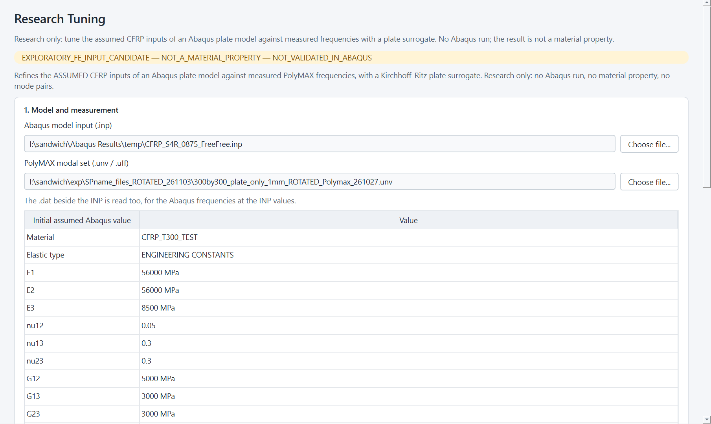
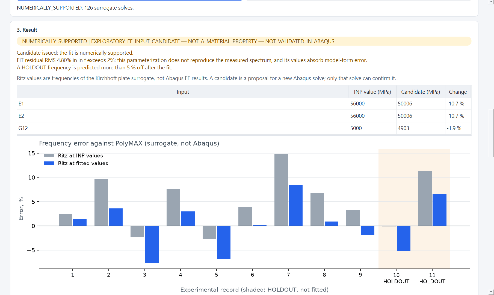
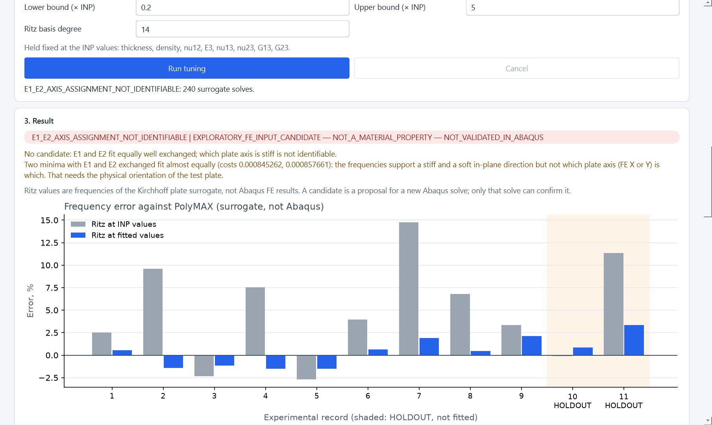
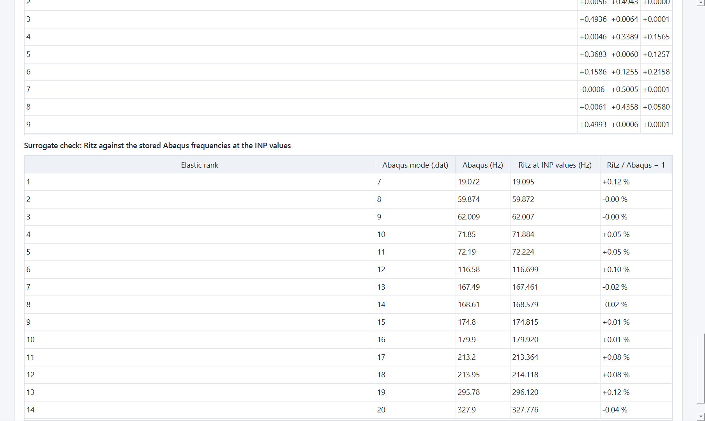
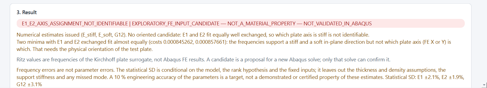

# REAL-FIT.R1 report: exploratory frequency tuning of the M11 Abaqus CFRP inputs

Status: **REAL-FIT.R1 REVIEW_READY**. Not self-accepted.

For the owner and the reviewer. Base `217de0519793919d368fb2b60b1516d1fdef522f`; branch `feature/materials-offline-v1`; `origin/main`
`0bea1de68dc346d20958e6f53a9e1d634a870f5d`. The commit SHA is in the hand-over.

Every result is labelled **EXPLORATORY_FE_INPUT_CANDIDATE — NOT_A_MATERIAL_PROPERTY — NOT_VALIDATED_IN_ABAQUS**.

**Governance.**
- This is an owner-authorized research tool, separate from the governed inverse workflow, which still refuses real data with
  `NOT_AUTHORIZED`.
- Production Auto-ID was not used. SPEC v1.2, M8 GATE NOT_MET and D-077 NO_GLOBAL_PARAMETER_VALUE are unchanged.
- No Abaqus process, FE solve or file change took place. The INP, .dat and UNV were only read; their hashes were equal before and
  after.

## Result

| Fitted inputs | Outcome | E1 (MPa) | E2 (MPa) | G12 (MPa) | FIT RMS error, before → after | HOLDOUT RMS error, before → after |
|---|---|---|---|---|---|---|
| E1 = E2, G12 | **Candidate issued**, with warnings | 50 006 (−10.7 %) | 50 006 | 4 903 (−1.9 %) | 6.8 % → 4.8 % | 7.6 % → 5.9 % |
| E1, E2, G12 | **No candidate: `E1_E2_AXIS_ASSIGNMENT_NOT_IDENTIFIABLE`** | 59 643 or 44 171 | 43 593 or 58 724 | 4 824 / 4 817 | 6.8 % → 1.4 % | 7.6 % → 2.4 % |

INP values: E1 = E2 = 56 000, G12 = 5 000, nu12 = 0.05 MPa. HOLDOUT records are 10 and 11 (180.14 and 191.60 Hz). The RMS errors
are RMS of ln(f_model / f_exp), shown as per cent.

What the numbers say:

1. **The surrogate stands in for the model.** At the INP values, the Kirchhoff-Ritz surrogate reproduces all 14 stored S4R elastic
   frequencies within +0.12 % / −0.04 % (FE 7–20, from the model's own `.dat`). The surrogate's error is small next to the 2–15 %
   test misfit.
2. **E1 = E2 is not adequate.** The common modulus drops 10.7 % and G12 1.9 %. The fit is unique (three starts, condition number
   2.3, correlation −0.28), but the residuals stay ±8 %. EXP 2 / 3 (54.6 / 63.5 Hz) and EXP 7 / 8 (145.9 / 157.9 Hz) are split pairs
   that a model with E1 = E2 predicts nearly together. The tool warns that these values absorb model-form error.
3. **Three parameters reproduce the spectrum, but the axis is open.**
   - The residuals fall to 1.4 % on FIT and 2.4 % on HOLDOUT, and each minimum is well conditioned (condition number 1.7, correlations
     under 0.22).
   - There are two minima with E1 and E2 exchanged, whose costs differ only through 301 against 300 mm.
   - So the frequencies support a stiffer (about 59 GPa) and a softer (about 44 GPa) in-plane direction, but not which plate axis
     (FE X or Y) is which. That is the physical orientation REAL-PLATE.R2 found missing, so **no candidate is issued**.
4. **G12 is about 4.8–4.9 GPa in every form, and rests almost entirely on EXP 1 (18.63 Hz).** Its sensitivity is
   d ln f / d ln G12 = 0.48, while E1 and E2 are under 0.01. That twist-like branch is also the frequency most exposed to the
   suspension and the shaker.

## Inputs (read, not assumed)

| Source | SHA-256 |
|---|---|
| `I:\sandwich\Abaqus Results\temp\CFRP_S4R_0875_FreeFree.inp` | `962f75f2fd5d9e6d97578df828599bc150b9777648392b29e8c856546af81df3` |
| `I:\sandwich\Abaqus Results\temp\CFRP_S4R_0875_FreeFree.dat` | `f440592598a21bd23dd7fa68f1032ebcd4d0da4d33b48156adc68ec690625de9` |
| `I:\sandwich\exp\SPname_files_ROTATED_261103\300by300_plate_only_1mm_ROTATED_Polymax_261027.unv` | `76db80aed1b4ba7062c0bf914cae85b55ea2665d80cb643c8cd54ba6c8bedc4d` |

**From the INP:**
- material `CFRP_T300_TEST`, `*Elastic, type=ENGINEERING CONSTANTS`: E1 56000, E2 56000, E3 8500, nu12 0.05, nu13 0.3, nu23 0.3,
  G12 5000, G13 3000, G23 3000;
- density 1.498e-9 t/mm³, shell thickness 0.875 mm, plan 301 × 300 mm from the nodes, model mass 118.36 g;
- no `*Orientation`.

**Experimental:** the 11 curve-fitted `Polymax_bravo` records, read through the program's importer, EXP 1 at 18.6307 Hz included. FRF
peak records are never used.

## Method

Service `services/research_frequency_tuning.py`; Qt-free model `new_gui/research_tuning_model.py`.

- **Constitutive model:**
  - one homogeneous orthotropic layer on the global axes, as the INP defines it; plane stress;
  - Q11 = E1/(1 − ν12ν21), Q22 = E2/(1 − ν12ν21), Q12 = ν12E2/(1 − ν12ν21), Q66 = G12, ν21 = ν12E2/E1, Dij = Qij t³/12;
  - E3, ν13, ν23, G13 and G23 are not in Kirchhoff theory and are kept from the INP.
- **Forward model:** the existing free-plate Kirchhoff-Ritz solver (`plate_ritz_forward.solve_ritz`), degree 14. Degrees 10, 14 and 18
  agree within 0.002 % on the first 12 modes.
- **Held fixed:** t, ρ, ν12 and the plan, at the INP values.
- **Correspondence:** a declared frequency hypothesis — the k-th kept experimental frequency against the k-th surrogate elastic rank,
  with optional user-declared ranks. It is not mode identity, and no nearest-frequency candidate becomes a pair.
- **Fit:** bounded least squares (scipy `least_squares`, TRF) on ln(f_model / f_exp) of the FIT records, in log parameters, within
  0.2–5 × the INP values. The Jacobian is a central difference of the surrogate.
- **Starts:** 3 for E1 = E2 and 4 asymmetric for E1, E2, G12, so that a mirror minimum shows itself.
- **Diagnostics:** sensitivities d ln f / d ln p, singular values, practical rank (singular-value ratio 1e-3), condition number,
  correlation and statistical SD of ln p (conditional on the model), active bounds, and agreement between the starts.
- **When a candidate is issued:** only when the fit converges, has full practical rank, a condition number of at most 1e3, no active
  bound, and starts that agree. Mirror minima are named as such.

## GUI: the "Research Tuning" page

The sidebar has a fifth page, all in English. It shows:
- the label banner;
- the INP and UNV choices; the INP's own values; the experimental records with FIT / HOLDOUT / EXCLUDED roles (the two highest are
  HOLDOUT by default); fitted-input choice, declared ranks, bounds and Ritz degree;
- Run and Cancel, with progress;
- the status, reasons and warnings; candidate values only when supported, and the minima otherwise;
- the before / after error plot with HOLDOUT shaded; the frequency table; convergence, rank and coupling; the sensitivities; and the
  surrogate-against-Abaqus check;
- **Export proposal (JSON)**: inputs, hashes, assumptions, request, every number, and the Abaqus `*Elastic` lines only when a candidate
  exists. The other constants are copied from the INP.

Exports of this run (not committed): `D:\git\abaqus-modal-comparator-work\runs\real_fit_r1\proposal_tied.json` and `proposal_free.json`.

| | |
|---|---|
| Inputs and roles |  |
| E1 = E2: candidate and errors |  |
| E1, E2, G12: mirror minima, no candidate |  |
| Surrogate against the stored Abaqus frequencies |  |

## Limitations

- **Surrogate, not Abaqus.** Ritz frequencies at fitted values are not FE results. The candidate E1 = E2 = 50 006, G12 = 4 903 MPa is
  a proposal for a new Abaqus solve, which this task did not run.
- **Assumption: specimen equivalence.** The 27 October test plate is assumed to be the M11 model's specimen (REAL-PLATE.R2: not
  verified).
- **Assumption: free-free.** The test hung the plate on two strings at about 45° with a shaker behind it; the model is free-free.
  Support stiffness enters every residual, most of all EXP 1, which alone carries G12.
- **The rank hypothesis.** The rank hypothesis assumes the measured set has no missing or extra mode up to 191.6 Hz; a skipped mode
  would shift every higher rank. EXP 4 and 5 sit close to near-degenerate FE pairs.
- **Thickness and density are held at the INP values.** Only E/ρ and G/ρ, scaled by t², are what the frequencies constrain. A
  different interior thickness changes the candidate moduli at fixed frequencies. The 0.875 mm is the mean of edge readings (M11 §8).
- **The SD values** are conditional on the model and the hypothesis; there is no measurement uncertainty model.
- **E1 / E2 axis.** The stiff-axis assignment needs the physical orientation (REAL-PLATE.R2 questions 3–4).

## Changed files

- **New:**
  - `src/services/research_frequency_tuning.py`;
  - `src/new_gui/research_tuning_model.py`, `src/new_gui/research_tuning_panel.py`;
  - `tests/test_real_fit_r1_tuning.py` (17 tests);
  - this report and `docs/materials/real_fit_r1/*.png`.
- **Changed:** `src/new_gui/production_window.py` (the fifth page; closing stops its job).
- **Changed tests:**
  - `tests/test_new_gui1_workspace.py`: the module list and the allowed imports;
  - `tests/test_universal_ui2_clean.py`: five pages; the owner-specified research page is exempt from the wording check, as the
    Materials study already is;
  - `tests/test_gui_ux_r1.py`: five pages.

## Tests and verification

Focused tests only; one process at a time, one BLAS thread. The full suite was not run.

- **New tests, 17:** `test_real_fit_r1_tuning`. They check:
  - reading the INP and the .dat;
  - the isotropic limit of the conversion;
  - recovery of known synthetic values, flagged as a software test;
  - mirror detection, the misfit warning, a bound, too few FIT frequencies, HOLDOUT independence, cancel, and the export;
  - the page: run, export, roles, cancel and a bad setting.
- **Affected modules:** with `test_new_gui1_workspace`, `test_universal_ui2_clean`, `test_gui_ux_r1`, `test_process_shutdown` and
  `test_mat4_ux1_materials_gui`, all pass after the changes above. The first run had 6 failures, all in the wording check, before the
  exemption.

**Windows GUI on the real files** (real `windows` platform, 1366 × 768 and 900 × 700 at 150 %):
- both fits ran, in 1.7 s and 2.4 s; both exports were written;
- no sideways scroll at 900; no Russian text;
- the source hashes were unchanged; no process started and nothing was written on `I:\`.

## REAL-FIT.R1.F1: numerical estimates without false physical certainty

**What changed.**
- **FE classification by shape only.** The 1 Hz rigid-body cutoff is removed. Rigid-body and elastic FE modes are now told apart only
  by shape, with the comparator's own criterion (`modal_data_viewer.classify_rigid_body_fe_modes`, rigid-body projection residual
  ≤ 0.02). It reads modes already extracted from an optional ODB, which is found by content; Abaqus is never started. Without such
  modes the classification is reported as UNAVAILABLE, and the surrogate is not compared with Abaqus by rank. The `.dat` frequencies
  are listed unclassified.
- **Start and bounds from the data.** Every modulus starts at an arbitrary 1000 MPa. Then:
  1. a common factor is taken from the mean log ratio of the measured to the surrogate frequencies (f ~ √modulus at fixed geometry
     and surface mass);
  2. one linearized least-squares step splits that factor between the parameters;
  3. the bounds are that start ÷ and × a search factor (default 10).

  The INP constants are shown for comparison only. A test shows that tripling them changes neither the start nor the result.
- **Estimates without an axis.** For E1, E2, G12, numerical **E_stiff, E_soft and G12** are reported even when the axis assignment is
  unresolved, and both assignments are listed side by side; none is chosen. The oriented Abaqus `*Elastic` block is still given only
  for a resolved candidate.
- **Quantity categories.** Each quantity is labelled MEASURED (the PolyMAX frequencies), FITTED, ASSUMED (INP) and FIXED (thickness,
  density), DERIVED (surface mass), MODEL GEOMETRY (the plan) or FIXED, NOT IDENTIFIED (nu12). E3, nu13, nu23, G13 and G23 are not in
  the surrogate and are kept from the INP.
- **The lowest experimental record stays in the fit.** A second fit without it is reported, as a check only.
- **What the fixed inputs carry.**
  - The thickness and density factors on the moduli come from the exact plate scaling.
  - Thickness ±5 % changes the moduli by a factor 0.864–1.166 when the surface mass is held, or 0.907–1.108 when the density is held.
  - Density ±5 % changes them by ±5 %.
- **The accuracy statement.** Frequency errors are not parameter errors. The statistical SD is model-conditional. A 10 % engineering
  accuracy is a target, not a demonstrated or certified property.

**Real run, with the shape-based classification** (rigid FE modes 3–6, elastic from mode 7; FE modes 1 and 2 not loaded):

| Fitted inputs | Status | Research estimates (MPa) and statistical SD | Without EXP 1 (check only) |
|---|---|---|---|
| E1 = E2, G12 | NUMERICALLY_SUPPORTED, with misfit warnings | E 50 006 ±4.7 %; G12 4 903 ±10.4 % | E −1.1 %; **G12 +9.4 %** (5 365) |
| E1, E2, G12 | E1_E2_AXIS_ASSIGNMENT_NOT_IDENTIFIABLE | **E_stiff 59 643 ±2.1 %; E_soft 43 593 ±1.9 %; G12 4 824 ±3.1 %** | E −0.5 %; G12 +4.0 % (5 019) |

- **Both axis assignments:**
  - A: E1(FE X) 59 643 / E2(FE Y) 43 593, cost 0.000845;
  - B: 44 171 / 58 724, cost 0.000858.
- **Start:** data-scaled E1 33 619 / E2 58 643 / G12 8 376 MPa; common factor 23.7 from 1000 MPa. The result is unchanged from R1, so
  it did not depend on the INP start.
- **Errors:** FIT 6.8 % → 1.4 %, HOLDOUT 7.6 % → 2.4 % RMS.

**Reading of the estimates.**
- E_stiff and E_soft are well separated by the data: condition number 1.7, correlation |r| ≤ 0.21.
- G12 leans on EXP 1: it moves 4–9 % without it.
- None of the SD values contains the thickness, density, support, rank-hypothesis or surrogate errors.
- A ±5 % thickness uncertainty alone moves the moduli by up to 16 %.
- **No 10 % parameter accuracy is claimed.**

**Tests and verification.**
- `test_real_fit_r1_tuning`: 21 tests, 4 of them new. They cover no frequency cutoff, the unavailable FE classification, the start
  being independent of the INP, the lowest-record check, the quantity categories and the accuracy statement, E_stiff / E_soft with both
  assignments, and the bound.
- With `test_new_gui1_workspace` (allowed services updated), `test_universal_ui2_clean` and `test_process_shutdown`: 70 tests OK.
- One Windows GUI pass on the real files, with the ODB copy for the classification:
  - both fits ran, in 2.6 s and 5.2 s;
  - no sideways scroll at 900 and no Russian text;
  - the sources were unchanged; no process started and nothing was written on `I:\`.

## REAL-FIT.R1.F2: frequency correspondence kept and validated

- **The check without the lowest record.** `_first_mode_check` now leaves out only the lowest kept record. Every other observation
  keeps its declared surrogate rank and its role (FIT / HOLDOUT). The earlier code renumbered the ranks and shifted them by one, which
  was right only for the default rank hypothesis. With a declared mapping it would have rematched the records.
- **Validation before any fit.** `validate_correspondence` runs before any optimization: every FIT or HOLDOUT record needs a whole,
  positive, unique rank of at most 60. A declared mapping that names an unknown or EXCLUDED record is refused.
- **The Declared ranks field** gives clear English messages for bad syntax, a repeated record or a rank below 1.
- **The page** checks the correspondence before it starts or clears anything. Roles, declared ranks and settings stay as entered.

**Real-data recheck (default rank hypothesis), F1 output against F2 output for the same script:** every number is **identical**.
- E1 = E2: E 50 005.787, G12 4 903.372.
- E1, E2, G12: E_stiff 59 643.14, E_soft 43 592.566, G12 4 824.07.
- FIT and HOLDOUT RMS before and after, condition numbers, and each record's residual.
- First-mode check: −1.13 % / +9.42 % and −0.47 % / −0.50 % / +4.04 %, with ranks 2–9 kept.

Under the default hypothesis the earlier renumbering happened to give the same ranks.

**Tests.**
- `test_real_fit_r1_tuning`: 27 tests, 6 of them new:
  - a declared mapping with a skipped surrogate rank, recovered exactly and kept by the first-mode check;
  - the default check's ranks;
  - a partial mapping that duplicates a rank, refused before any optimizer call;
  - unknown and EXCLUDED records and out-of-range ranks;
  - the parser messages;
  - the page keeping its inputs.
- With `test_new_gui1_workspace`: 55 tests OK.

**Windows GUI.** An invalid "3:4" mapping was refused with "rank 4 is assigned to records 3, 4", and the inputs and roles were kept.
Both fits then gave the same estimates as above. No sideways scroll at 900, no Russian text, sources unchanged, no process started.
