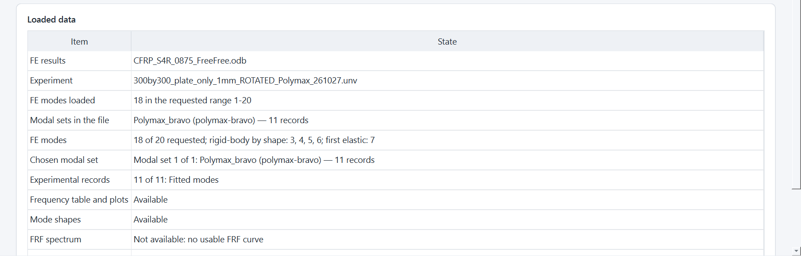
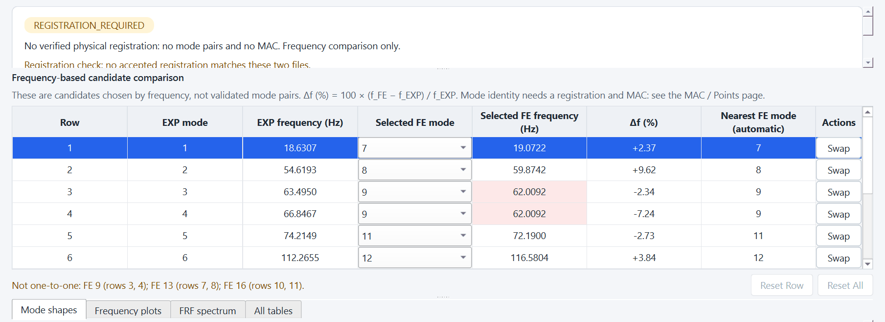
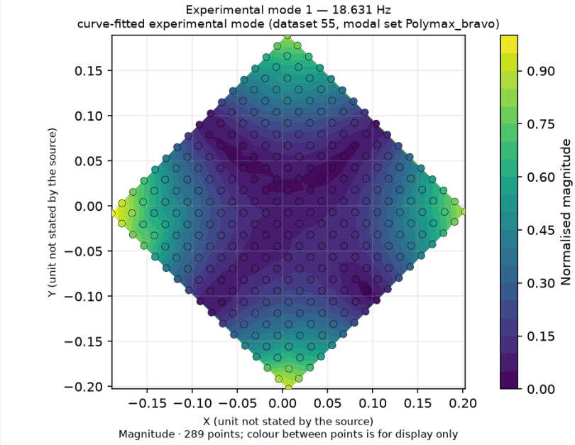
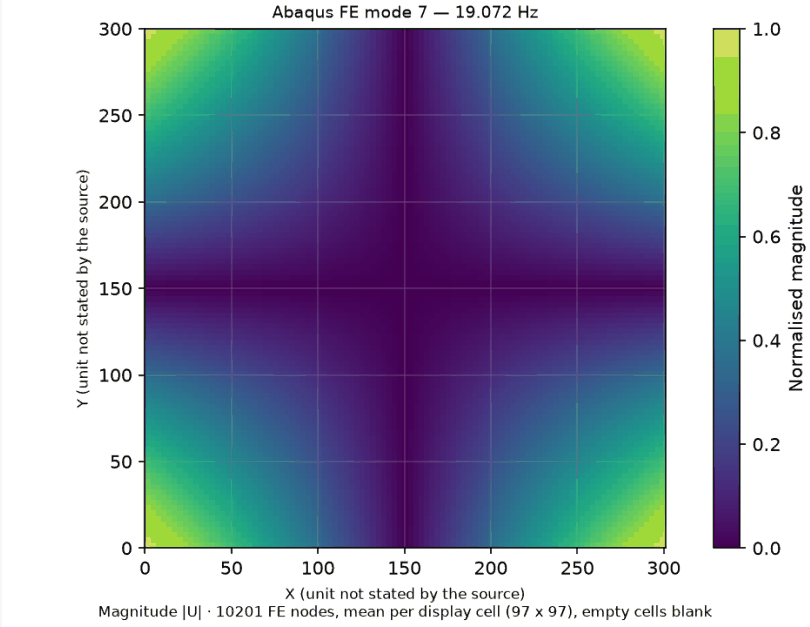
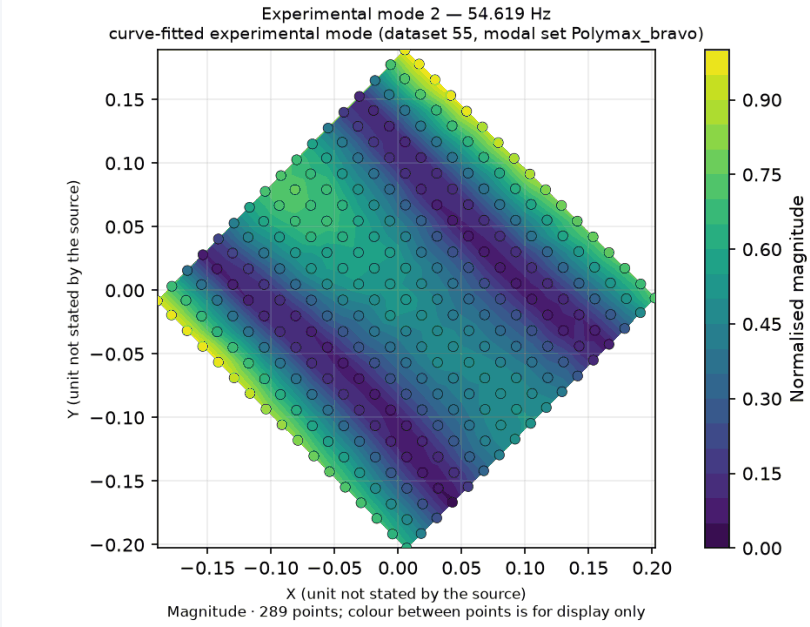
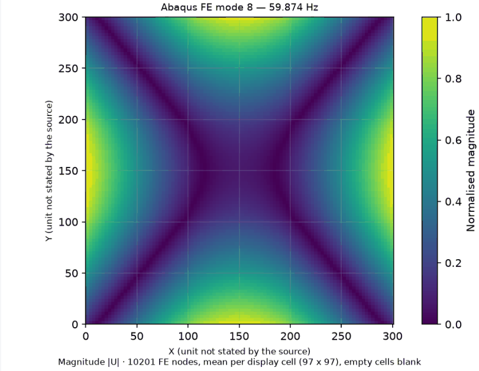
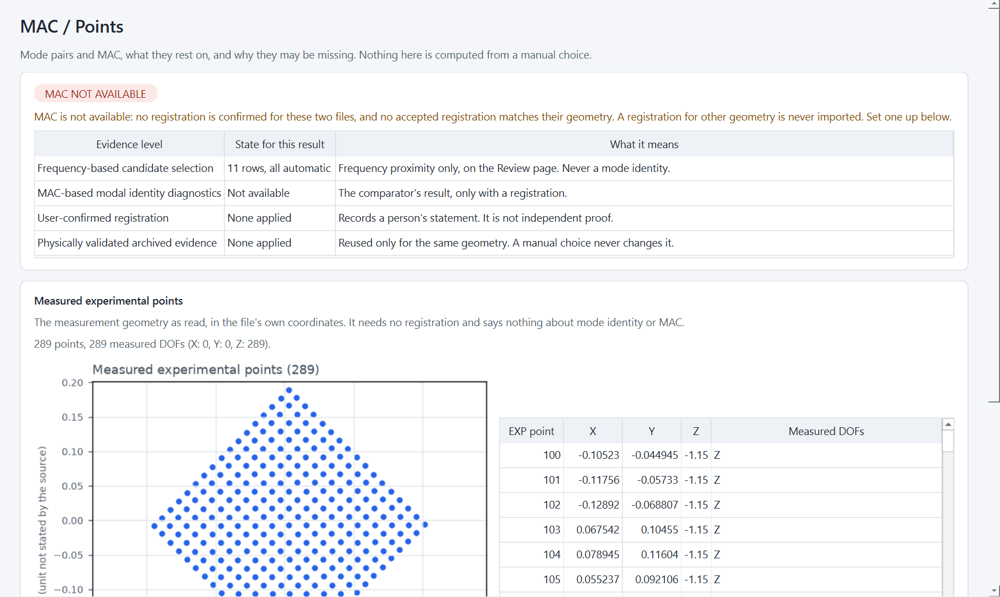
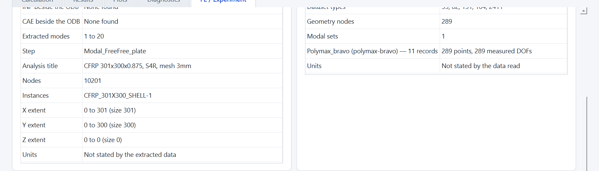
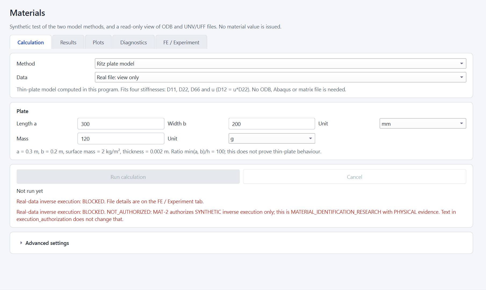

# REAL-PLATE.R1 report: the real single CFRP plate in the Windows application

Status: **REAL-PLATE.R1 REVIEW_READY**. Not self-accepted.

For the owner and the reviewer. Base: `a45a4e6f62800a24f0b6c53f3a21d7a9566afe94`; branch `feature/materials-offline-v1`; `origin/main`
`0bea1de68dc346d20958e6f53a9e1d634a870f5d`. The commit SHA is in the hand-over.

**Scientific status, unchanged:** M8 GATE NOT_MET, D-077 NO_GLOBAL_PARAMETER_VALUE, production Auto-ID BLOCKED, real-data inverse
execution BLOCKED. No Abaqus process, solver, FE run, MAC, registration, fit or material value. No E1, E2, G12, ply constant,
suspension stiffness or calibration is inferred.

## Result in one paragraph

The application reads the real PolyMAX file and the M11 FE results through its normal Analyze route and shows them together. It shows
all 11 fitted modes, including mode 1 at 18.6307 Hz, with their shapes, 289 measured points, coordinates and DOFs. The FE side shows
its modes and shapes, with the first elastic mode 7 at 19.0722 Hz found by shape. No physical registration exists for these two files,
so the result is **REGISTRATION_REQUIRED: a frequency comparison only, no mode pairs and no MAC**. The 18.63 / 19.07 Hz proximity
(+2.37 %) is shown as a frequency-based candidate, not a mode pair. One misleading range note was fixed. Everything was checked on the
real Windows window, in English.

## 1. Sources (read-only)

| Role | File | SHA-256 | Size |
|---|---|---|---|
| Experimental modal set | `I:\sandwich\exp\SPname_files_ROTATED_261103\300by300_plate_only_1mm_ROTATED_Polymax_261027.unv` | `76db80aed1b4ba7062c0bf914cae85b55ea2665d80cb643c8cd54ba6c8bedc4d` | 421 096 |
| FRF of the same session (auxiliary) | `…\300by300_plate_only_1mm_ROTATED_261027.unv` | `d3bc99e9d0fd8261fd878b83fc8eec8b27206cec23eeea240d2a3cd7712b9878` | 31 383 254 |
| FE results (M11) | `I:\sandwich\Abaqus Results\temp\CFRP_S4R_0875_FreeFree.odb` | `7daeb7e35adf6bd6fabe8f9f582859935ca3d8927ae32fcf07a35c38e8c023b8` | 5 873 772 |
| FE input and output text beside it | `CFRP_S4R_0875_FreeFree.inp` / `.dat` | `962f75f2…df3` / `f4405925…de9` | — |

**Identification, independently of file names:**

- **Experimental files.** Both are byte-identical to files already inventoried by NEW-EXP-R1 (`docs/experimental/new_exp_20261029`):
  - the PolyMAX file was `…_ROTATED_Polytec_261027.unv`, renamed by the lab (`exp\Read me.txt`: "Polytec" was a naming error);
  - the FRF file is `…_ROTATED_261027.unv`, unchanged.

  Dataset 151 names the Test.Lab project `300by300_plate_only_1mm_ROTATED_261027`, exported 29-Oct-26 15:58:21. The session is
  `NEXP29/PLATE300-1MM/S261027-ROTATED`, provisional specimen `PLATE-300x300x1mm`.
- **FE file.** Its SHA-256 equals the M11 verified copy (V3) and the input of the authorized M11 R6 extraction
  (`docs/reconciliation/M11_SINGLE_CFRP_PLATE.md` §12). The model is S4R, 301 × 300 mm, t 0.875 mm, E1 = E2 = 56 000, G12 = 5 000
  (template constants), free-free.
- **Not established: that the M11 model represents this specimen.** M11 was built for the plate of session 261016. That the 261027
  ROTATED plate is the same physical plate is **not confirmed** (NEW-EXP-R1, "Plate identity"); only the file names suggest it.
  Everything below is therefore an FE ↔ experiment *display and frequency diagnostic*, not a validated comparison of one specimen.

Hashes of both `I:\` sources were equal before and after every run. Nothing was written on `I:\`.

## 2. How the FE results were loaded without Abaqus

The normal Analyze route looks for an extracted package beside the ODB (`<odb stem>_modal_packages`) by the ODB's SHA-256, and
otherwise asks the user to start Abaqus Python. Neither option was allowed: no Abaqus, and no writing beside the source.

What was done (`D:\git\abaqus-modal-comparator-work\runs\real_plate_r1\prepare_fe_package.py`, log `prepare_fe_package_log.json`):

1. The ODB was copied to the work folder, with the hash checked before, after and on the source again: all three equal.
2. Beside the copy, a package was made from a **byte copy** of the existing authorized extraction of the same ODB content: M11 R6,
   2026-10-21, `abaqus python`, `readOnly=True`, unchanged extractor SHA-256 `039aa067…`. All 22 files were hashed equal.
3. The package's `extraction_source.json` states this provenance (`"ADOPTED, NOT RE-EXTRACTED"`).

The application then found the package by content and said "Abaqus is not needed". The consent dialog was never called: 0 calls were
recorded. No application code was changed for this.

## 3. Experimental data, as the application shows them

- **Set:** `Polymax_bravo`, 11 fitted records (dataset 55), 289 points, complex shapes.
- **Measured component:** Z only. X and Y are zero at every point in the file; the application shows "289 measured DOFs (X 0, Y 0,
  Z 289)".
- **Residual records:** the two PolyMAX residuals (below 14.90 Hz and above 240.95 Hz) are excluded.

| EXP | Hz | Damping ratio (record header) | Classification |
|---|---|---|---|
| 1 | **18.6307** | 0.001892 | curve-fitted experimental mode |
| 2 | 54.6193 | 0.003935 | " |
| 3 | 63.4950 | 0.001595 | " |
| 4 | 66.8467 | 0.009231 | " |
| 5 | 74.2149 | 0.002711 | " |
| 6 | 112.2655 | 0.006402 | " |
| 7 | 145.9357 | 0.007828 | " |
| 8 | 157.8508 | 0.001018 | " |
| 9 | 169.1849 | 0.002997 | " |
| 10 | 180.1363 | 0.000637 | " |
| 11 | 191.6019 | 0.008086 | " |

**Coordinates (dataset 2411):**
- 289 nodes in the global system (CS 0 / 0, no local system).
- x −0.1893…0.2023, y −0.2026…0.1889, z −1.15 for every node (the stated Polytec distance).
- Dataset 164 is `USER_DEFINED` with factors 1.0; the size is consistent with metres. The application says "unit not stated by the
  source", which is a conservative reading.

**Scan grid** (from the experimental geometry only):
- 17 × 17 points at about 17.4 mm;
- the grid lines lie at 45.2° in the scanner frame;
- the span is about 277 × 277 mm along the grid lines.

This agrees with the lab note "rotated 45° clockwise as viewed from the Polytec system". It does not say which grid line is FE X or Y,
or which face was measured.

**FRF file of the same session**, read through the same path: 22 FRF peak records, every one `PROVISIONAL — NOT A VALIDATED FITTED
MODE`. The first is 3.4375 Hz and is kept. Registration is "not checked: FRF peak records". Peaks are never treated as fitted modes.

## 4. FE data, as the application shows them

- **Package:** S4R, instance `CFRP_301X300_SHELL-1`, 10 201 nodes, X 0–301, Y 0–300, Z 0 (mid-surface); step `Modal_FreeFree_plate`.
- **Modes 1 and 2:** not loaded, with a visible warning. The extraction recorded their frequency as "1 Hz" and "2 Hz", but the frame
  descriptions say 0.0 Hz. This is a known quirk of `extract_odb.py`: for a zero-frequency frame it falls back to `frameValue`, the
  mode number. The quirk is already caught by the reader, so it is not a display defect. It was not changed, because the extractor runs
  only inside Abaqus.
- **Rigid-body modes:** 3–6, identified by shape (0.0002–0.0021 Hz).

| FE | Hz | | FE | Hz |
|---|---|---|---|---|
| 7 (first elastic) | **19.0722** | | 14 | 168.6080 |
| 8 | 59.8742 | | 15 | 174.7977 |
| 9 | 62.0092 | | 16 | 179.9016 |
| 10 | 71.8499 | | 17 | 213.1995 |
| 11 | 72.1900 | | 18 | 213.9528 |
| 12 | 116.5804 | | 19 | 295.7755 |
| 13 | 167.4903 | | 20 | 327.9010 |

## 5. The permitted comparison: frequency only

- **Status:** `REGISTRATION_REQUIRED`. The registration check says "the experimental file SHA-256 76db80aed1b4… is not the PolyMAX
  source of an accepted physical registration".
- **MAC / Points:** "MAC NOT AVAILABLE".

The Review page lists nearest-frequency candidates, and calls them "candidates chosen by frequency, not validated mode pairs":

| EXP | Hz | Nearest FE | Hz | Δf | Note |
|---|---|---|---|---|---|
| 1 | 18.6307 | 7 | 19.0722 | +2.37 % | below the lowest elastic FE mode (19.07 Hz) |
| 2 | 54.6193 | 8 | 59.8742 | +9.62 % | |
| 3 | 63.4950 | 9 | 62.0092 | −2.34 % | FE 9 also nearest to EXP 4 |
| 4 | 66.8467 | 9 | 62.0092 | −7.24 % | |
| 5 | 74.2149 | 11 | 72.1900 | −2.73 % | |
| 6 | 112.2655 | 12 | 116.5804 | +3.84 % | |
| 7 | 145.9357 | 13 | 167.4903 | +14.77 % | FE 13 also nearest to EXP 8 |
| 8 | 157.8508 | 13 | 167.4903 | +6.11 % | |
| 9 | 169.1849 | 14 | 168.6080 | −0.34 % | |
| 10 | 180.1363 | 16 | 179.9016 | −0.13 % | FE 16 also nearest to EXP 11 |
| 11 | 191.6019 | 16 | 179.9016 | −6.11 % | |

The application itself flags "Not one-to-one: FE 9, FE 13, FE 16".

**EXP 1 against FE 7.**
- **What is shown:** a frequency proximity, and two magnitude images side by side, each in its own coordinates:
  - EXP 1 is large at the four plate corners, with low bands through the centre;
  - FE 7 is the twist of the free plate, with nodal lines on both centre lines.
- **What it is not:** a mode identity. Magnitude images carry no signs, the frames are not registered, no MAC was computed, the model
  constants are a template, and the specimen identity with M11 is unconfirmed. The M11 caution about the much higher first mode of the
  older 261016 session (33.45 Hz) also applies: the two sessions are not paired (NEW-EXP-R1, `MODE_IDENTITY_NOT_VERIFIED`).

## 6. Physical-registration readiness

The application's own registration service (`generic_registration`, called through `analyze_model.propose_registration`) was given
only what the evidence supports:
- FE unit mm (M11 model, 301 × 300);
- experimental unit m (dataset 164 and the extents);
- measured DOF z (the file).

Result: **`REGISTRATION_REQUIRED` — "Still needed: the measured side; at least one landmark (experimental point, FE node)."** Nothing
was invented. The evidence still missing:

1. **The 45° turn:** its reference orientation. Which plate edge or corner is where in the scanner frame, and whether the 301 mm edge
   is FE X.
2. **The measured face.**
3. **Landmarks.** There is no `.svd` / PSV frame for the 261027 ROTATED session, so the M11 frame reconstruction cannot be reused.
4. **Specimen identity:** that the 261027 plate is the M11 plate.
5. **Model:** the suspension (two upper points on the first-mode nodal line, per the lab note) and the excitation. The FE model is
   ideal free-free.
6. **Distance:** whether the 1.15 m Polytec distance affects the PolyMAX shapes (NEW-EXP-R1 open point 4).

## 7. Software defect fixed

**The range note named the wrong FE range.**
- **What was wrong:** EXP 1 (18.6307 Hz) was annotated "below the lowest extracted FE mode (19.07 Hz)". FE modes 3–6 were extracted
  below it and are shown on the same page, and 19.07 Hz is the model's first elastic mode, not the end of an incomplete extraction.
- **Cause:** the bound comes from the elastic modes only (rigid-body modes are separate records since P-2), but the wording said
  "extracted".
- **Fix:** both owners now say "below the lowest elastic FE mode": `services/new_odb_comparison.FrequencyOnlyDiagnostic.range_note`
  (Analyze / Review) and `services/diagnostic_report._range_note` (the diagnostic report). The "above the highest extracted FE mode …
  extend the Abaqus mode range" note is unchanged.
- **Tests:** a regression test with the real-plate numbers in each of `tests/test_new_odb_comparison.py` and
  `tests/test_diagnostic_report.py`; the existing expectation in `test_new_odb_comparison.py` was updated. Retested on the real files
  in the real window: the note now reads "below the lowest elastic FE mode (19.07 Hz)".

**Observations, not fixed:** neither blocks the real-data workflow, and neither is a defect of import or display.
- On Materials, choosing "Real file: view only" leaves the **synthetic** plate fields (300 × 200 mm, 120 g) on screen. Running stays
  blocked and the values are not used, but a reader could take them for the real plate. Suggested follow-up: hide or grey the plate
  card for a real source.
- Dataset 164 units are not read: "unit not stated by the source".

## 8. Real Windows GUI run

Real `windows` Qt platform, a visible window at 1366 × 768 on a 150 % screen, the program's own entry point and event loop. Files
were passed to the panels' own `choose_file`; the file dialog was the only step skipped. The Abaqus consent was replaced by a recorder
that answers No. It was never called.

Checks: 11 of 11 PASS, exit code 0.
- **Files and processes:** Analyze in 2.1 s, no consent request. No process start, no write on `I:\`, no KK-VIM path. Both sources
  unchanged.
- **Results:** FE 7 at 19.0722 Hz is the first elastic mode, rigid modes 3–6. EXP 1 at 18.6307 Hz is present. 11 of 11 records.
  `REGISTRATION_REQUIRED`, no pairs and no MAC.
- **Materials:** "Real file: view only" disables the run, and a direct call is refused with `NOT_AUTHORIZED`. 0 study calls.
- **Language and errors:** 9 788 visible texts on the four pages, none Russian. No unhandled exception, no Qt warning.

Screenshots (all of the real data):

| View | |
|---|---|
| Analyze: loaded data |  |
| Review: frequency candidates, EXP 1 / FE 7 shown |  |
| EXP 1, 18.631 Hz (scanner frame) / FE 7, 19.072 Hz |   |
| EXP 2, 54.619 Hz / FE 8, 59.874 Hz (frequency candidates only) |   |
| MAC / Points: MAC not available; measured points, coordinates, DOFs |  |
| Materials → FE / Experiment: facts of both files |  |
| Materials: real source, inverse execution BLOCKED |  |

The scripts, logs and all screenshots are in `D:\git\abaqus-modal-comparator-work\runs\real_plate_r1\`:
- `gui_real_plate.py`, `gui_console.txt`, `gui_log.jsonl`;
- `probe_analyze.py`, `probe_registration.py`, `probe_frf.py`, `inspect_unv.py`;
- `analysis_model_output.json`, `registration_readiness.json`, `unv_raw_blocks.json`.

## 9. Focused tests

The full suite was not run. Runs were one process at a time with one BLAS thread.

`test_new_odb_comparison`, `test_diagnostic_report`, `test_new_gui4_diagnostic`, `test_odb_import_service`,
`test_local_experimental_preview`, `test_local_fe_preview`, `test_universal_reg1_registration`, `test_universal_two_file_analysis`:
**206 tests OK** (128 s).

## 10. Changed files

- `src/services/new_odb_comparison.py`, `src/services/diagnostic_report.py`: the range-note wording.
- `tests/test_new_odb_comparison.py`, `tests/test_diagnostic_report.py`: one updated expectation and two regression tests.
- `docs/materials/REAL_PLATE_R1_REPORT.md` and `docs/materials/real_plate_r1/*.png`: this report.

No SPEC, DECISIONS, registration evidence, threshold, extractor, importer or frozen record was changed.
